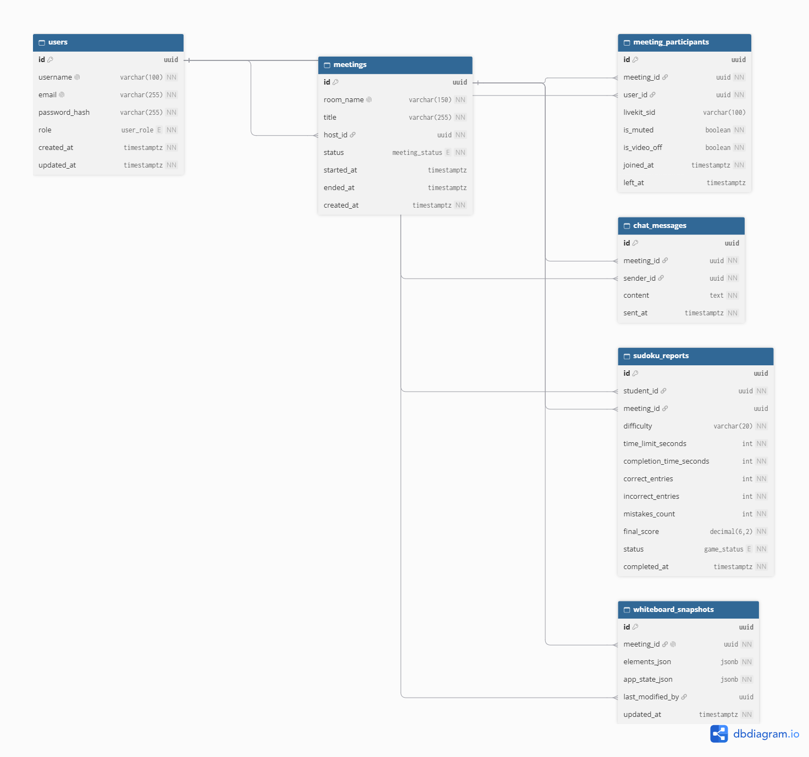

# Interactive Learning & Collaboration Platform Architecture

Teachers and students sign in to a single application and work inside a live meeting. From that meeting they share audio and video, exchange chat, draw on one whiteboard, play a timed Sudoku game, and read a generated performance report. A text-to-speech control converts typed text into spoken audio in the browser.

Two roles exist: **Student** and **Teacher**. The interface and the permissions follow the signed-in role.

## System view

## Runtime flows

### Join a meeting

1. A teacher creates a meeting through the REST API. The row is stored in `meetings` with the teacher as `host_id`. The LiveKit token service creates the LiveKit room.
2. A student (or the teacher) requests a join token over HTTPS. The token service returns a LiveKit JWT for that room.
3. The LiveKit React SDK connects to the SFU over WebRTC. Microphone, camera, and participant state stay on that media path.
4. The backend records the participant in `meeting_participants` (`livekit_sid`, mute, video, `joined_at`, and later `left_at`).

### Chat

1. The chat drawer emits `chat_msg` over Socket.IO.
2. The ASGI server publishes the message through Redis so every participant in the meeting receives it.
3. The same server persists the message through the async database layer into `chat_messages` (sender, content, `sent_at`).
4. A client that reloads the meeting reads history from PostgreSQL. Persistence covers the assessment requirement to keep chat history during the session, and it also survives a refresh.

### Whiteboard

1. Excalidraw emits `scene_update` over Socket.IO when a participant draws, writes, adds a shape, undoes, clears, or changes color.
2. Redis holds the active scene and presence so other participants apply the update immediately.
3. The server writes a snapshot through the database layer into `whiteboard_snapshots`: `elements_json` and `app_state_json` (JSONB), plus `last_modified_by` and `updated_at`. One snapshot row exists per meeting.

### Sudoku report

1. The SPA engine runs the puzzle: countdown, move validation, and score tracking.
2. When the game ends, the client sends `POST /reports` with the JSON Web Token.
3. The REST API stores completion time, correct and incorrect entries, mistake count, final score, and completion status in `sudoku_reports`.
4. The student can read their report. The teacher can read it where the meeting relationship makes that appropriate.

## Data model

Primary keys are UUIDs. PostgreSQL holds the durable rows. Redis holds Socket.IO traffic, the live whiteboard, and presence, and those keys are not tables in this schema.

Enum **type names** on the diagram are `user_role`, `meeting_status`, and `game_status`. The assessment fixes `user_role` as `student` and `teacher`. Members of `meeting_status` and `game_status` are not printed on the diagram. The values below are design assumptions:

- `meeting_status`: `scheduled`, `live`, `ended`
- `game_status`: `completed`, `abandoned`, `timed_out`

`NN` in the tables below means the diagram marks the column not null. Columns without that mark are nullable on the diagram.

Lookup tables (`cities`, `schools`) feed registration. Role profile tables (`students`, `teachers`) extend `users` one-to-one.

### `cities`

| Column | Type | Notes |
| --- | --- | --- |
| `id` | uuid | Primary key |
| `name` | varchar(100) | NN, unique |

### `schools`

| Column | Type | Notes |
| --- | --- | --- |
| `id` | uuid | Primary key |
| `name` | varchar(150) | NN |
| `city_id` | uuid | NN, foreign key to `cities` |

Unique constraint `uq_schools_name_city` on `(name, city_id)`.

### `users`

| Column | Type | Notes |
| --- | --- | --- |
| `id` | uuid | Primary key |
| `username` | varchar(100) | NN, unique |
| `email` | varchar(255) | NN, unique |
| `password_hash` | varchar(255) | NN |
| `role` | `user_role` | NN. `student` or `teacher` |
| `created_at` | timestamptz | NN |
| `updated_at` | timestamptz | |

### `students`

| Column | Type | Notes |
| --- | --- | --- |
| `id` | uuid | Primary key |
| `user_id` | uuid | NN, unique, foreign key to `users`. One profile per user |
| `class_name` | varchar(50) | NN |
| `date_of_birth` | date | NN |
| `city_id` | uuid | NN, foreign key to `cities` |
| `school_id` | uuid | NN, foreign key to `schools` |

### `teachers`

| Column | Type | Notes |
| --- | --- | --- |
| `id` | uuid | Primary key |
| `user_id` | uuid | NN, unique, foreign key to `users`. One profile per user |
| `qualification` | varchar(255) | NN |
| `city_id` | uuid | NN, foreign key to `cities` |
| `experience_years` | int | NN |

### `meetings`

| Column | Type | Notes |
| --- | --- | --- |
| `id` | uuid | Primary key |
| `room_name` | varchar(150) | NN, unique. LiveKit room name |
| `title` | varchar(255) | NN |
| `host_id` | uuid | NN, foreign key to `users` |
| `status` | `meeting_status` | NN |
| `started_at` | timestamptz | |
| `ended_at` | timestamptz | |
| `created_at` | timestamptz | NN |

### `meeting_participants`

| Column | Type | Notes |
| --- | --- | --- |
| `id` | uuid | Primary key |
| `meeting_id` | uuid | NN, foreign key to `meetings` |
| `user_id` | uuid | NN, foreign key to `users` |
| `livekit_sid` | varchar(100) | LiveKit participant identifier |
| `is_muted` | boolean | NN |
| `is_video_off` | boolean | NN |
| `joined_at` | timestamptz | NN |
| `left_at` | timestamptz | |

### `chat_messages`

| Column | Type | Notes |
| --- | --- | --- |
| `id` | uuid | Primary key |
| `meeting_id` | uuid | NN, foreign key to `meetings` |
| `sender_id` | uuid | NN, foreign key to `users` |
| `content` | text | NN |
| `sent_at` | timestamptz | NN. Shown with the sender name in the chat drawer |

### `sudoku_reports`

| Column | Type | Notes |
| --- | --- | --- |
| `id` | uuid | Primary key |
| `student_id` | uuid | NN, foreign key to `users` |
| `meeting_id` | uuid | Foreign key to `meetings`. Optional when the game is not tied to a live meeting |
| `difficulty` | varchar(20) | NN |
| `time_limit_seconds` | int | NN |
| `completion_time_seconds` | int | NN. Total completion time |
| `correct_entries` | int | NN |
| `incorrect_entries` | int | NN |
| `mistakes_count` | int | NN |
| `final_score` | decimal(6,2) | NN |
| `status` | `game_status` | NN. Game completion status |
| `completed_at` | timestamptz | |

These columns are the performance report the assessment requires after each completed game.

### `whiteboard_snapshots`

| Column | Type | Notes |
| --- | --- | --- |
| `id` | uuid | Primary key |
| `meeting_id` | uuid | NN, unique, foreign key to `meetings`. One snapshot per meeting |
| `elements_json` | jsonb | NN. Excalidraw elements |
| `app_state_json` | jsonb | NN. Excalidraw app state, including view and tool settings needed to restore the board |
| `last_modified_by` | uuid | Foreign key to `users` |
| `updated_at` | timestamptz | NN |